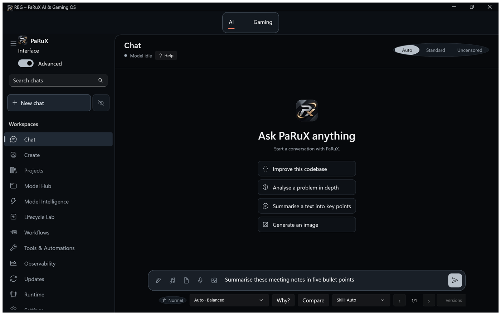
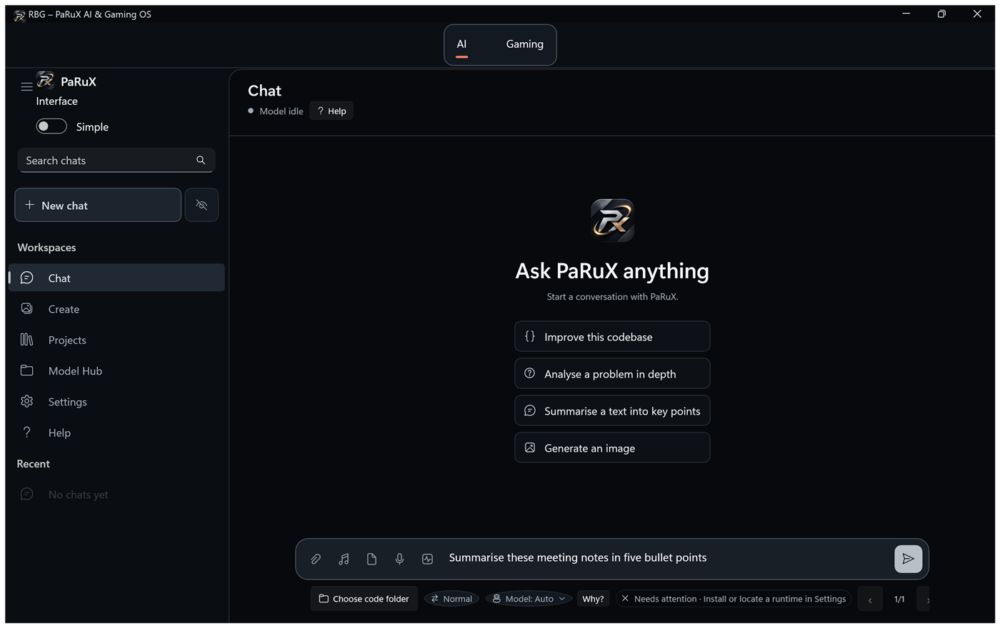
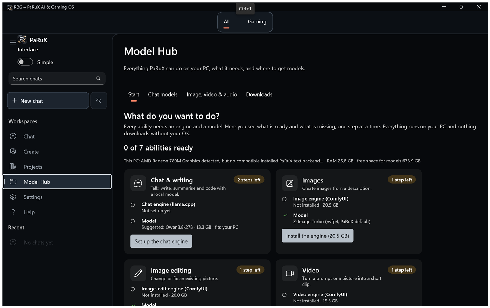
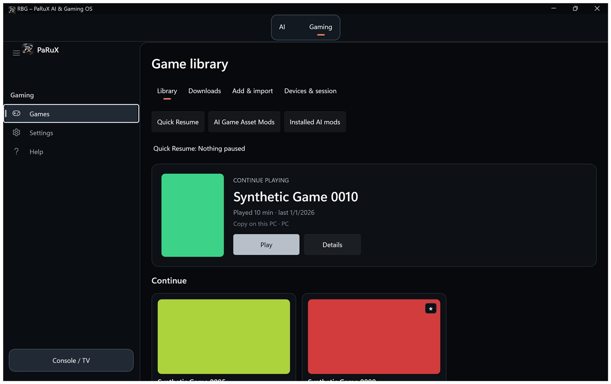
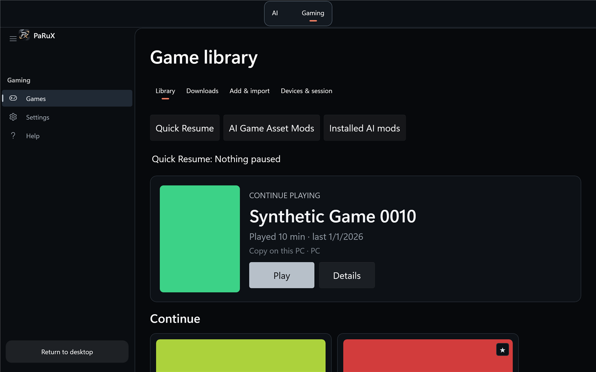
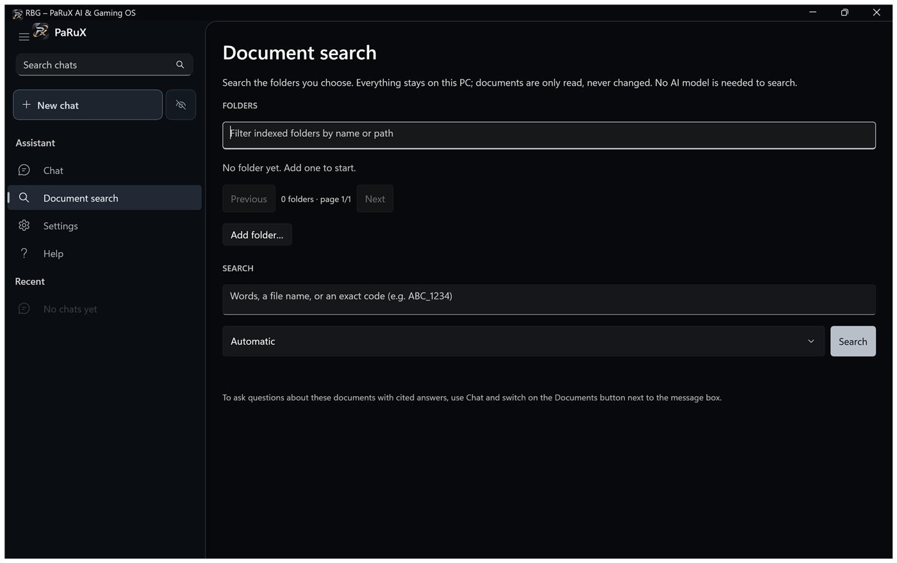
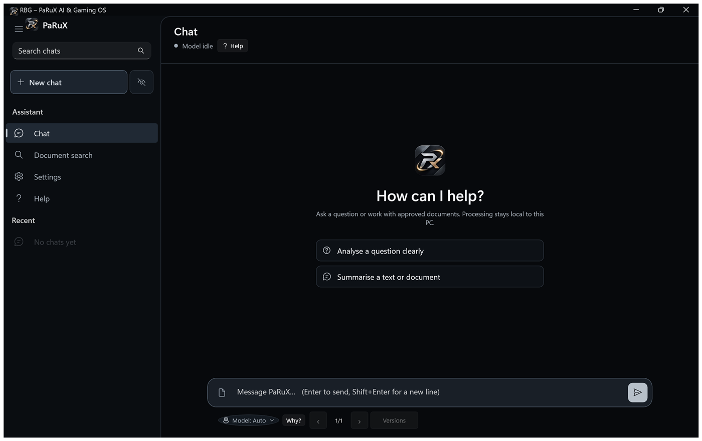
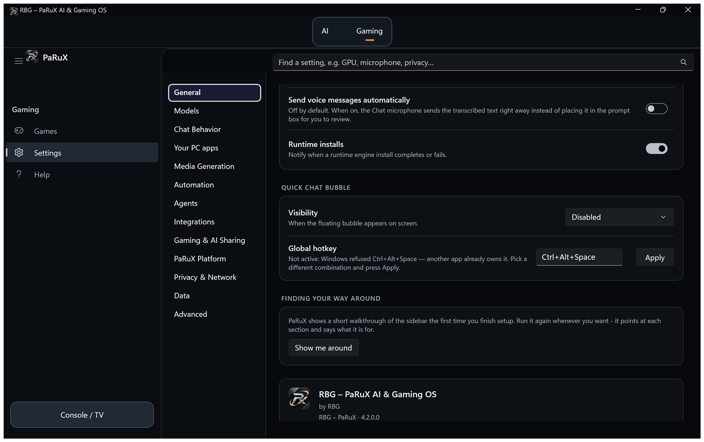

# RBG – PaRuX AI & Gaming OS

  

<strong>Your local AI workspace and gaming console home, powered by your own PC.</strong>

Local models, smart routing, chat, creative tools and agents, plus a game library and Console / TV mode — in one Windows application.

  <a href="https://github.com/Ruba94-cyber/RBG-PaRuX-AI-Gaming-OS/releases"><strong>Download releases</strong></a> ·
  <a href="#what-can-you-do">Features</a> ·
  <a href="#screenshots">Screenshots</a> ·
  <a href="PARUX_EXECUTION_PLAN.md">Roadmap</a> ·
  <a href="#support-parux"><strong>Donate ❤️</strong></a>

  
  
  

> **BETA — v4.3.1 pre-release (20 November 2026); earlier pre-releases: v4.3.0 (20 November), v4.2.0 (15 November) and v4.1.0 (10 November).** The 4.0.1 stable-channel release is still the default GitHub `latest` until the owner promotes a newer version. PaRuX is an experimental project, **not yet a stable release**. Features and interfaces may change, some capabilities are still being tested on real hardware, and bugs are possible. Please use it with this in mind and [report issues](https://github.com/Ruba94-cyber/RBG-PaRuX-AI-Gaming-OS/issues).

## What is PaRuX?

**PaRuX is a local-first AI workspace for Windows**, evolving toward an integrated AI and gaming experience. It brings different AI models and workflows together without making you manage a separate app for every task. Your own PC handles local inference; external AI services are **optional and disabled by default**. “OS” describes the intended integrated experience; PaRuX runs on Windows and does not replace it. An early, opt-in fullscreen Console/TV presenter and a consent-based manual game library are implemented in the source, with read-only Steam/Epic/GOG discovery, an opt-in combined library scan and paginated browsing of detected titles, and explicitly confirmed Steam/GOG GALAXY launch requests plus an Epic Windows-protocol activation request (actual game start is not verified; manual Return to AI required; not yet Windows-tested); the complete controller-first Console Shell, universal game library and store installation workflows remain in development and have not passed Windows acceptance.

## What can you do?

- **Chat with local AI:** streaming conversations, images and documents, saved chats, projects and knowledge search.
- **Discover and manage models:** explore Hugging Face, download models with progress and resume, and link models from compatible local tools without copying them.
- **Choose the right model automatically:** hardware-aware suggestions, smart routing for chat, coding and other tasks, or manual model selection when you want full control.
- **Create in the same app:** experimental image generation and editing, video, music, speech, background removal and 3D workflows, including media requests directly from Chat.
- **Work with coding agents:** plan, implement, review and test changes with task progress and reviewable results.
- **Use Computer Use:** run approval-aware Windows tasks rather than giving an AI unrestricted desktop access.
- **Connect your tools:** optional file and knowledge sources, Skills, MCP, workflows and a local API compatible with popular AI clients.
- **Keep control of performance:** runtime suggestions, local benchmarks, model optimization and a Gaming Mode to reduce competition for PC resources. The desktop Games view also offers explicit SHA-256 inspection of local installers; this never executes or installs files and does not establish their safety. The Games/Console home now provides a user-confirmed Return-to-AI action without closing the game, and an explicitly requested read-only XInput/display diagnostic view; real Windows acceptance is still pending. The Games workspace also includes source-implemented, on-demand display and XInput diagnostics (not Windows-verified). Voice input and speech warmup are disabled when Gaming Mode is active by default; owned speech-process shutdown and GPU resource release remain under validation.
- **Manage and optionally deploy game downloads (experimental):** HTTPS, user-supplied v1 magnet/.torrent via integrated BitTorrent (single-file or multifile packaged as a ZIP), queue/pause/progress, and opt-in **verified portable ZIP** extraction + local-library registration after download. The owner must supply a separate SHA-256, chosen ZIP name, relative game EXE and title before enqueue. No unattended setup.exe/MSI/script execution, unauthorized source catalogue, DRM bypass or automatic game launch. Source WIP; Windows tests are pending.
- **Optional reversible ZIP mod delivery (source WIP):** after generating and reviewing a PNG overlay, PaRuX can place its own verified ZIP into an **existing, user-selected** `mods`, `resourcepacks` or `addons` folder ONLY when the owner confirms that a specific offline game's loader accepts that exact standalone ZIP format, chooses the actual local game executable and confirms the game is closed. PaRuX independently checks whether that selected executable is still running (including Quick Resume suspension), then checks again immediately before ZIP publication or deletion; differently named helper processes cannot be verified universally. It writes a new unique filename without overwriting existing mods, stores a pre-copy receipt and removes only matching SHA-256 bytes after a second explicit approval. Installed-mod history is accessible in Gaming Home. This does **not** imply universal mod support, automatic texture/model hot reload or compatibility with any specific game. Windows acceptance remains unrun.
- **Game-independent Local AI Asset Mod Studio (source WIP):** available directly from Gaming Home, not dependent on Minecraft or on pausing a process. Import a real PNG from an authorized offline game, enter a documented virtual replacement path for a compatible mod/resource loader, describe a colour/material change, and preview a dimension/alpha-preserving candidate generated with PaRuX's LOCAL image engine. After separate approval, export a bounded ZIP holding only the replacement PNG and a manifest; source assets, game files and executables remain untouched. Explicit adapter capability listing distinguishes manual PNG overlays, game-specific skins and temporary config patches. **Does not imply compatibility, automatic installation, universal hot reload or game-model editing. Windows build/GPU/mod-loader acceptance remain unrun.**
- **Local AI Minecraft Skin Studio (source WIP):** two local-model workflows: (1) import a 64×64 existing Java skin, then recolour just head, torso, arms, legs or the full character while preserving Classic/Slim UV geometry, existing unselected pixels and transparency; (2) experimental generation of a new candidate atlas from scratch. Review before consent-gated PNG export. Nothing changes Minecraft files/accounts automatically; artistic quality, Windows build and real import remain unverified. Generation stays off in Gaming Mode.
- **AI temporary game mods (experimental):** when a PaRuX-managed offline portable game is actually paused with Quick Resume, local AI can request a human-approved text config proposal (.ini/.cfg/.json/.txt). The user compares the original and proposed text, explicitly applies it with a saved rollback receipt, and can later restore the original. Automatic restore after the original process exits is implemented in source with conflict-safe SHA checks, but does not guarantee live in-game reload or work with anti-cheat/memory edits. The feature is currently **uncompiled source WIP**.
- **Access it your way:** Windows desktop first, plus an optional browser client and an Android companion for supervising the Windows host.

Available features depend on your installed models, runtimes and hardware. **Not every feature or model will work on every PC during beta.**

## Standard Portable: standalone offline packaging (source only)

The current **unreleased** Standard Portable builder now requires a bundled CPU `llama.cpp` runtime, Vulkan runtime, Qwen3-4B GGUF starter, ONNX embeddings and reranker, plus self-contained Desktop/Core binaries. The ZIP includes a `parux.portable` marker and adjacent `PaRuXData`: launching `PaRuX.exe` directly or relocating the extracted directory is designed to preserve Chat history, model files, indexing and settings **without referencing the host PC's `Documents/LocalAI` or installed models**. The dedicated Corporate CPU shell and diagnostic shell are marked INTERNAL and use separate staging paths/output names, so they cannot overwrite the full Standard package.

On the **Windows BUILD PC**, use `scripts/build-portable.ps1 -FetchAssets -Smoke` to prepare and verify the local assets before delivery; the target user should not need to install .NET, the Windows App Runtime, Python, Ollama or LM Studio for **base Chat and document retrieval**. The built ZIP has not yet passed fresh-machine native Windows/FlaUI, actual text inference, RAG quality or relocation tests. Advanced generation/training, system drivers, game launchers and their optional dependencies are **not** promised fully prebundled. The code is not part of the published 4.1.0 beta. Enterprise Corporate portability may require NTFS ACL support and IT approval; removable FAT/exFAT drives are not certified.

## Corporate Lite: fully offline requires the right package

The **Corporate Lite with Qwen3-4B** package includes a CPU `llama.cpp` runtime and the starter GGUF for offline text chat. The separately distributed **NoModel** variant does **not** contain a chat model; installing it alone is not a complete standalone chat setup. Neither variant is enterprise-certified. For a verified document-search build, the local embedding ONNX model is required, and a cross-encoder ONNX reranker can now be bundled using `-RerankerDir` / `-Fetch` plus `-RequireReranker` during packaging. Files, runtime and model licences must be reviewed before distribution.

**Validation still pending on the current source:** a clean 8–16 GB CPU-only Windows PC, real offline document ingestion + search + source-grounded response, machine networking/egress, failure recovery, signed binaries and full regression testing. The `-EnforceAcceptance` mode in `tests/corporate/measure-corporate-lite.ps1` explicitly rejects missing dependencies and non-functional real-chat/RAG smoke on a fresh extracted package. A passing source check or HTTP 200 is not proof of functional RAG. See [release readiness](docs/RELEASE_READINESS.md) and the [canonical execution plan](PARUX_EXECUTION_PLAN.md).

## Why RBG – PaRuX?

Local AI usually means one app per task and a separate launcher for games. RBG – PaRuX aims to put them in one Windows application: chat, models, documents, creative tools and agents on your own PC, with a game library that gets out of the way of your GPU when a game starts. The principles are local-first inference, Chat as the home screen, advanced capabilities opened as workspaces (a Normal interface and an Advanced/Studio one), and honest status: what is verified, partial or missing is stated in the [execution plan](PARUX_EXECUTION_PLAN.md).

## Modes

| Mode | What it is | Status | Guide |
|---|---|---|---|
| **AI** | Chat, Create, Projects, Model Hub and, in Advanced, routing, workflows, tools, runtimes and updates | PARTIAL (beta) | [FAQ](docs/guides/FAQ.md) |
| **Gaming** | Game library, store discovery, hard-off of AI while a game runs, Return to AI | PARTIAL; real-game hard-off measured, FPS impact NOT RUN | [GAMING](docs/guides/GAMING.md) |
| **Console / TV** | Opt-in fullscreen presenter with a larger-scale library; D-pad/stick, A, B/Escape | Early foundation, not a finished Console Shell | [CONSOLE_MODE](docs/guides/CONSOLE_MODE.md) |
| **Corporate Edition** | Offline CPU-only Corporate Lite: chat and document search, no cloud | PARTIAL; no roles or audit log | [CORPORATE](docs/guides/CORPORATE.md) |

## Screenshots

Real captures of the running Windows app (isolated data root, synthetic game titles, no personal data). The model engines are not installed in these captures, so Chat shows its honest setup state.

| | |
|---|---|
|  Home / Chat |  AI workspace (Advanced) |
|  Chat composer |  Model Hub |
|  Gaming library (synthetic titles) |  Console / TV mode |
|  Document search (Corporate) |  Corporate Edition chat |
|  Settings, About | |

## System requirements

Figures come from the project's measurements on one reference PC (Ryzen 7 8840U, 25.8 GB RAM, Radeon 780M, and an RTX 5080 external GPU for the GPU runs). They are guidance, not guarantees; other hardware is unverified. See [PERFORMANCE_BENCHMARKS.md](docs/PERFORMANCE_BENCHMARKS.md).

| Use | RAM | GPU / VRAM | Disk |
|---|---|---|---|
| Operating system | Windows 10 or newer, x64 | | |
| App and Core, idle | about 0.5 GB (App about 256 MB, Core about 197-230 MB working set) | none | MSI download about 0.8 GB; Portable ZIP about 0.2 GB |
| Small model on CPU (Corporate Lite, Qwen3-4B Q4_K_M) | about 7 GB in use during a document run on the reference PC; a true 8 GB PC is **NOT verified** | none (about 13 tokens/s, first token about 14 s) | ZIP with model about 2.7 GB |
| Same 4B model on a GPU | model file 2.3 GiB; about 1 GB system RAM | about 4.3 GB VRAM at 16K context (195.8 tokens/s measured on the RTX 5080, **unverified on current commits**) | model file 2.3 GiB |
| Larger models (for example a 30B Q3 coder model) | more | about 14 GB VRAM observed | several GB per model |

A dedicated GPU is recommended for large models and media generation but is not required for small CPU models. Image, video and training engines are optional components, some of which need an NVIDIA GPU. Installed size was not measured.

## Install

1. Get a build from [GitHub Releases](https://github.com/Ruba94-cyber/RBG-PaRuX-AI-Gaming-OS/releases). If no assets are listed, no public installer is available yet.
2. Verify the SHA-256 and signature, run the MSI, and start RBG – PaRuX from the Start Menu. Full steps and known limits: [INSTALL.md](docs/guides/INSTALL.md).
3. Launch it, review the suggested setup (Detect, then Locate existing / Install with PaRuX / Skip). Downloads require your confirmation.
4. To build from source (Windows, .NET 10 SDK) see [RELEASING.md](docs/RELEASING.md) and [AI_LOCAL_SETUP.md](docs/AI_LOCAL_SETUP.md).

**Portable:** extract the ZIP to an NTFS folder and run `PaRuX.exe`; data stays in `PaRuXData` beside it. See [PORTABLE.md](docs/guides/PORTABLE.md).

**Android companion:** an optional controller for PaRuX running on Windows, **not** a standalone mobile inference engine. See [Android setup](docs/PARUX_ANDROID_README.md).

## Set up a model

1. Open **Model Hub**. Pick a suggested model for your hardware, search Hugging Face, or import a GGUF file you already have. A starter such as Qwen3-4B Q4_K_M is the size used in the measurements above.
2. Confirm the download (progress and resume are shown). Models are never downloaded silently.
3. Open **Chat** and send a message; the runtime starts when a request needs it. Routing can choose a model automatically or you can select one.
4. The 4.1.0 MSI and Portable packages do not bundle a chat model; only the Corporate Lite with-model package does.

## Add games

Open **Games**, then **Add & import**: add a local executable, scan your stores (read-only discovery, opt-in), or import an emulator folder. Launching asks for confirmation, and AI is stopped while the game runs. See [GAMING.md](docs/guides/GAMING.md).

## Import documents

In the AI mode, add a folder as a knowledge source and wait for indexing; answers can cite the files they came from. Corporate Lite offers this as **Document search** with **Add folder...** and requires a local embedding model. Scanned-PDF OCR is NOT verified. See [CORPORATE.md](docs/guides/CORPORATE.md).

## Update

MSI: open **Updates** (Advanced interface) and choose **Download & install verified MSI**; it installs only a signed, newer release. Portable: replace the application files and keep `PaRuXData`. Details in [INSTALL.md](docs/guides/INSTALL.md).

## Guides

[Install](docs/guides/INSTALL.md) · [Portable](docs/guides/PORTABLE.md) · [Corporate](docs/guides/CORPORATE.md) · [Gaming](docs/guides/GAMING.md) · [Console / TV](docs/guides/CONSOLE_MODE.md) · [Troubleshooting](docs/guides/TROUBLESHOOTING.md) · [FAQ](docs/guides/FAQ.md) · [Privacy](docs/guides/PRIVACY.md) · [Release notes template](docs/guides/RELEASE_NOTES_TEMPLATE.md)

## Local-first, with choices

- **Local inference comes first.** You do not need an OpenAI, Anthropic or other paid cloud API for normal local use.
- **Cloud fallback is off by default** and only available when you explicitly configure it.
- **Models and runtimes are not silently downloaded or switched**: suggestions are yours to accept or decline.
- **Internet features are optional**, except when you choose actions such as downloading models, checking updates or doing online research.
- **Remote browser access is opt-in.** The desktop PC remains the execution host; see [local gateway and integrations](docs/UNIVERSAL_GATEWAY.md).

## Project status

**PARTIAL — v4.1.0 beta published; later source changes still require native Windows validation and PHYSICAL_PC_ACCEPTANCE_REQUIRED.** The canonical status and the open work (the BIC-01 to BIC-17 backlog) live in [PARUX_EXECUTION_PLAN.md](PARUX_EXECUTION_PLAN.md). Earlier "software complete" markers in the documentation are dated historical evidence, not the status of the current code. The Release build and the test classes touched in the latest fixes pass; the full xUnit suite and the FlaUI UI tests were NOT RUN for this statement.

## Historical validation matrix (5 November 2026 — superseded by the 10 November 4.1.0 evidence)

Status refers to a **specific test or delivery**, not to the entire product. Earlier PRs have been merged onto `main`; the latest source-only increments, including GOS-13, are not compiled, run or release-verified.

| Capability / evidence | What is established | What remains |
|---|---|---|
| Latest published release | **4.1.0 beta pre-release** (4.0.1 remains the stable-channel GitHub `latest`) | Built and signed on the owner's Windows PC; see GitHub Releases |
| Baseline Server tests (before PR merges) | **Auto-tested on Windows**: 12,410 passed, 9 skipped (handoff dated 5 Nov 2026) | Newly merged PR tests are **Authored-not-run**, must not inherit prior evidence |
| FlaUI desktop | **Verified on Windows**: Smoke 34/34. Prior full suite 270/283; 11 failures rerun passed after the bundled Core was refreshed | Run the **complete** Regression suite again by itself against the final source |
| Coding diff and safe permissions (L2) | Main runtime/sandbox exists; **Merged source, authored-not-compiled** PR #1 adds strict metadata-checked per-hunk review, SHA-256 preview and OS + all-mutation-tools Auto admission | Rejects unknown metadata, unreviewable sections, binary/rename/add/delete; no transactional apply, UI or Windows tests |
| Model comparison / personas (L3) | Arena/PersonaService on main; **Merged source, authored-not-compiled** PR #2 adds owner-only Core POST/GET, DTO/client, IT/EN statuses, advanced-only Chat Compare button, shared-prompt side-by-side dialog with refresh/cancel, and conservative VRAM preview policy | **FlaUI Smoke, HTTP security and focused xUnit authored-not-run**; no Windows UI, GPU/model-fit or 8 GB reference hardware proof; normal Chat routing unchanged |
| Local game knowledge and GPU guard (L8) | Existing document Chat and Gaming hard-off; **Merged source, authored-not-compiled** PR #3 now verifies selected source IDs against independently supplied eligible local index IDs and blocks GPU admission for unknown game state | No Chat UI or index wiring; **Needs physical HW** for GPU isolation proof |
| Auto-suspend and controllers (L6/L7) | Existing Quick Resume, virtual-pad and HidHide source; **Merged source, authored-not-compiled** PR #4 adds per-game suspend/debounce policies (3/5/10s, verified-process resets), anti-cheat guards and controller previews | **Needs physical HW**: event/sensor sampling, anti-cheat detection, device recovery; no XOutput-equivalence claim |
| External library, wishlist and compliance (L4/L5/L9) | PR #5 metadata preview plus **new uncompiled main WIP**: local Steam wishlist with owner-only settings and bilingual UI; explicit one-shot price quote reuses Discover's opt-in, rate limit, HTTPS allow-list and Gaming hard-off | Windows build/UI/security tests and real-world Store JSON not verified. A requested country is **not** a verified Steam account region. No automatic price polling, alert delivery, purchases or complete i18n/accessibility validation |
| Integrated BitTorrent (GOS-13) | **Main source WIP, not compiled/tested:** MonoTorrent 3.0.2, source-selected v1 magnets/local torrents, verified bounded staging, safe multifile-to-ZIP packaging, no unattended seeding; DPAPI-encrypted native-job recovery shown paused on restart | Verify Windows NuGet/build, real peer swarm, piece rehash/restart, pause/cancel/Gaming hard-off, bandwidth/disk-full/cleanup, FlaUI and provider integrity. Raw multifile folder deployment and unattended installers remain unavailable |
| Corporate Lite | Offline AI-only CPU runtime; model-inclusive 4B and NoModel package variants; source now permits local ONNX reranker, requiring rebuilt package | Low-end 8 GB PC, complete real document answer and every-new-commit Windows gates **not established** |

Merged source PRs: [L2 PR #1](https://github.com/Ruba94-cyber/RBG-PaRuX-AI-Gaming-OS/pull/1), [L3 PR #2](https://github.com/Ruba94-cyber/RBG-PaRuX-AI-Gaming-OS/pull/2), [L8 PR #3](https://github.com/Ruba94-cyber/RBG-PaRuX-AI-Gaming-OS/pull/3), [L6/L7 PR #4](https://github.com/Ruba94-cyber/RBG-PaRuX-AI-Gaming-OS/pull/4), [L4/L5/L9 PR #5](https://github.com/Ruba94-cyber/RBG-PaRuX-AI-Gaming-OS/pull/5). See [HANDOFF.md](HANDOFF.md) for the independent Windows gate and [PARUX_EXECUTION_PLAN.md](PARUX_EXECUTION_PLAN.md) for status lines. All merged source remains local-first; no new model/driver downloads or game piracy support.

## Beta limitations

- Development and acceptance testing are ongoing; **this is not production-ready software**.
- The current media paths have been exercised on a Windows PC with an NVIDIA GPU. Other GPUs, CPU-only systems and low-VRAM configurations have not received equivalent physical-PC validation.
- Hands-free microphone input has not yet been confirmed in live use on the reference PC.
- Some advanced model families, training options and workflows are not implemented yet. See the [changelog](CHANGELOG.md) and [project roadmap](PARUX_EXECUTION_PLAN.md) for the current status.
- Linux and macOS are **not supported** as PaRuX desktop platforms.

## More information

- [Changelog](CHANGELOG.md) · [Roadmap](PARUX_EXECUTION_PLAN.md) · [Local AI setup](docs/AI_LOCAL_SETUP.md) · [User guides](docs/guides/INSTALL.md) · [Privacy](docs/guides/PRIVACY.md)
- [First-party dependency strategy](docs/DEPENDENCY_STRATEGY.md) · [Third-party notices](THIRD_PARTY_NOTICES.md) · [Code provenance](OPEN_SOURCE_PROVENANCE.md)
- [Architecture](docs/ARCHITECTURE.md) · [Android companion](docs/PARUX_ANDROID_README.md) · [Universal AI gateway](docs/UNIVERSAL_GATEWAY.md)
- [Report a bug or suggest an improvement](https://github.com/Ruba94-cyber/RBG-PaRuX-AI-Gaming-OS/issues) · [Contributing](CONTRIBUTING.md) · [Security](SECURITY.md)

## License

PaRuX is **source-available** under [FSL-1.1-MIT](LICENSE), **not an OSI-approved open-source license**. Each released version converts to MIT two years after its release. Third-party models and runtimes retain their own licenses.

## Support PaRuX

PaRuX is free to use, with **no required subscription or paid feature unlocks**. If you enjoy the project, you can support its continued development with an entirely optional donation.

Thank you for supporting PaRuX — donations never unlock or restrict features.

---

Made by Paolo Rubagotti · <a href="https://github.com/Ruba94-cyber/RBG-PaRuX-AI-Gaming-OS/releases">Releases</a> · <a href="docs/guides/INSTALL.md">Documentation</a> · <a href="https://github.com/Ruba94-cyber/RBG-PaRuX-AI-Gaming-OS/issues">Feedback</a> · <a href="#support-parux">Support the project</a>

